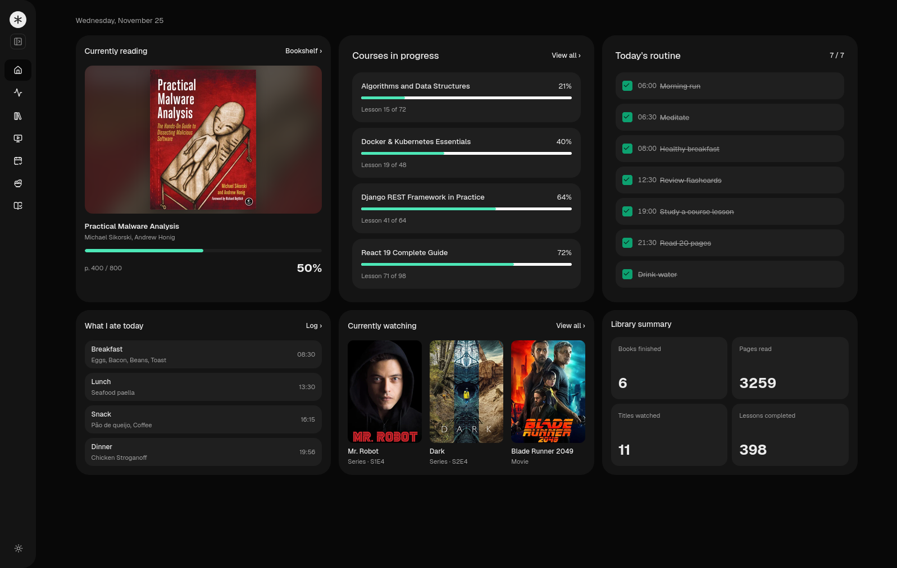
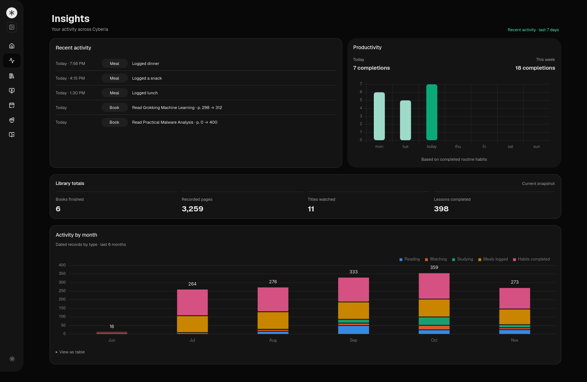
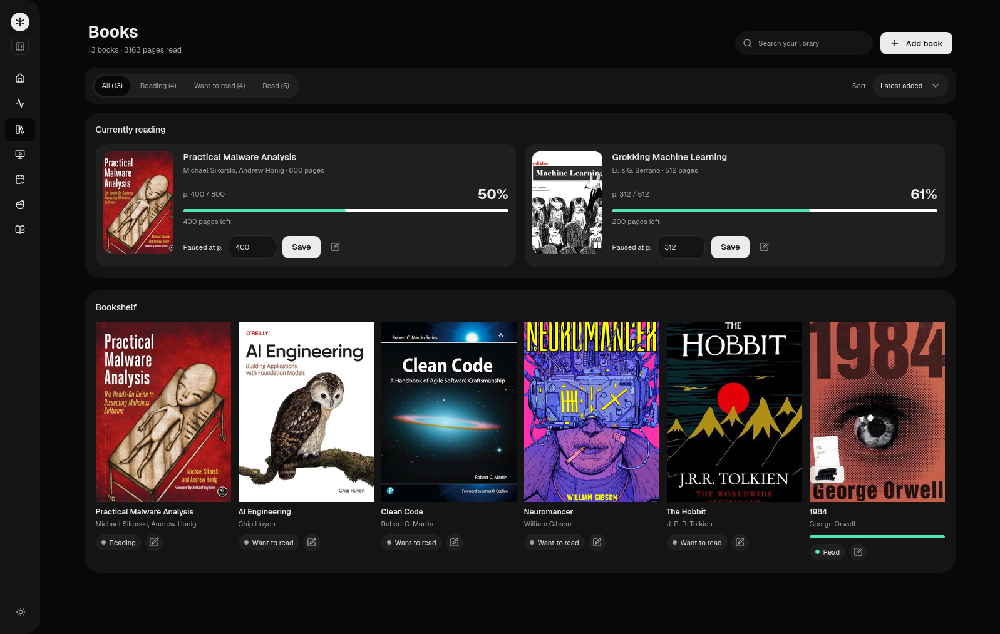
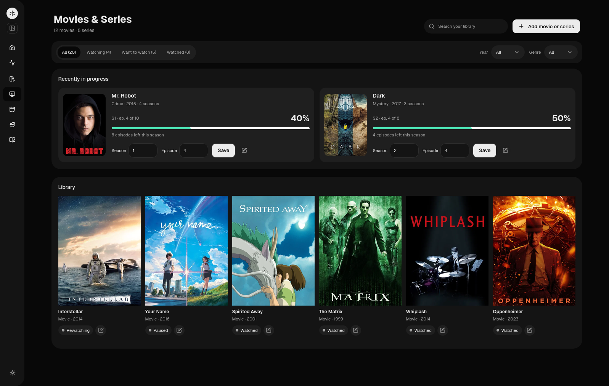
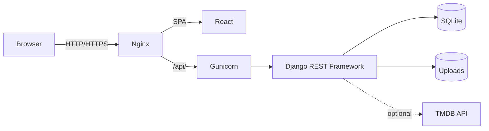

# Cyberia

A web app to track books, movies & series, courses, routine and meals in one place.

<samp>homepage</samp>


<samp>dashboard</samp>


<samp>books</samp>


<samp>movies & series</samp>


---

**Stack:** Django 6 + DRF (Python 3.14) · React 19 + TypeScript + Vite · Nginx · Gunicorn · SQLite · Docker Compose

---

## Architecture



## Quick start

```bash
git clone https://github.com/wh0islu/cyberia.git
cd cyberia
cp backend_cyberia/.env.examples backend_cyberia/.env   # set SECRET_KEY
docker compose up --build -d
```

Open **http://localhost:5173**.

Generate a `SECRET_KEY` with:

```bash
docker run --rm python:3.14-slim python -c "import secrets; print(secrets.token_urlsafe(64))"
```

## Documentation

| Topic                                  | Description                           |
| -------------------------------------- | ------------------------------------- |
| [Docker](docs/docker.md)               | Running, volumes and data persistence |
| [Backend](backend_cyberia/README.md)   | Django API setup and development      |
| [Frontend](frontend_cyberia/README.md) | React app setup and development       |
| [API collection](bruno/)               | Bruno requests for the API            |

## License

Copyright (C) 2025–2026 wh0islu.

This program is free software: you can redistribute it and/or modify it under the
terms of the GNU Affero General Public License as published by the Free Software
Foundation, either version 3 of the License, or (at your option) any later version.
See [LICENSE](LICENSE) for details.
