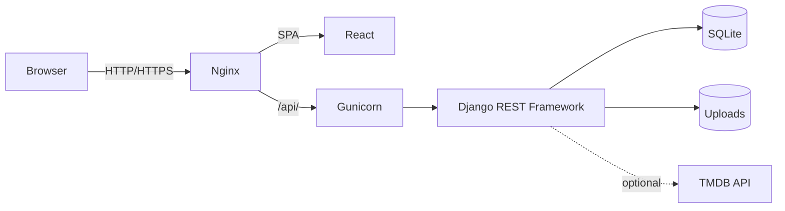

# Cyberia

A web app to track books, movies & series, courses, routine and meals in one place.

**Stack:** Django 6 + DRF (Python 3.14) · React 19 + TypeScript + Vite · Nginx · Gunicorn · SQLite · Docker Compose

## Quick start

```bash
git clone https://github.com/wh0islu/cyberia.git
cd cyberia
cp backend_cyberia/.env.examples backend_cyberia/.env   # set SECRET_KEY
docker compose up --build -d
```

Open **http://localhost:5173**.

Generate a `SECRET_KEY` with:

```bash
docker run --rm python:3.14-slim python -c "import secrets; print(secrets.token_urlsafe(64))"
```

## Architecture



## Documentation

| Topic | Description |
| --- | --- |
| [Docker](docs/docker.md) | Running, volumes and data persistence |
| [Backend](backend_cyberia/README.md) | Django API setup and development |
| [Frontend](frontend_cyberia/README.md) | React app setup and development |
| [API collection](bruno/) | Bruno requests for the API |
