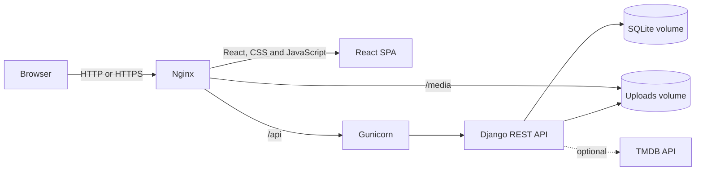

# Cyberia

**Stack:** Python 3.14, Django 6, Django REST Framework, React 19, TypeScript, Vite, Nginx, Gunicorn, SQLite, Docker Compose

---

### Architecture



Nginx is the only published service. It serves the compiled React application
and uploaded files, and proxies API requests to Gunicorn. Gunicorn runs the
Django application, while SQLite and user uploads are stored in persistent
Docker volumes.

---

## Run the Project

Clone the repository:

```bash
git clone https://github.com/wh0islu/cyberia.git
cd cyberia
```

Create the backend environment file:

```bash
cp backend_cyberia/.env.examples backend_cyberia/.env
```

Generate a secure Django secret key:

```bash
docker run --rm python:3.14-slim python -c "import secrets; print(secrets.token_urlsafe(64))"
```

Replace the `SECRET_KEY` placeholder in `backend_cyberia/.env` with the
generated value. The optional `TMDB_ACCESS_TOKEN` enables movie and series
search and automatic metadata.

Build and start the application:

```bash
docker compose up --build -d
```

Open [http://localhost:5173](http://localhost:5173). Database migrations run
automatically before Gunicorn starts.

Check the services and follow their logs:

```bash
docker compose ps
docker compose logs -f
```

Stop the application without deleting its data:

```bash
docker compose down
```

> `docker compose down --volumes` permanently deletes the Docker database and
> uploaded files.

---

## Project Description

### Objective

Cyberia is a personal web application for organizing media, learning, meals and
weekly routines in one place. It provides progress tracking, summaries and
daily views without depending on separate applications for each activity.


---

### Main Features

- **Home:** consolidated view of current reading, courses, routine, meals and
  library statistics.
- **Books:** reading status, page progress, covers, metadata and personal notes.
- **Movies & Series:** watch status, movie runtime progress, series episode
  progress and optional TMDB metadata.
- **Courses:** lesson and module progress, goal dates and certificate tracking.
- **Routine:** weekly habits, scheduled days and daily completion history.
- **Meals:** daily meal entries, items, tags, notes and optional photos.
- **Insights:** charts and activity summaries derived from the stored data.

---

### Backend

The backend is a Django REST API organized by domain. Each domain keeps its
models, serializers, endpoints and tests separated while sharing
common request parsing and CSRF protection.

- Gunicorn runs Django with three workers.
- The container entrypoint validates `SECRET_KEY` and applies pending migrations.
- SQLite is stored in the `cyberia_database` Docker volume.
- Uploaded images are stored in the `cyberia_uploads` Docker volume.
- API writes require a valid CSRF cookie and token.
- The backend port and Django administration panel are not publicly exposed by
  the Docker configuration.

---

### Frontend

The frontend is a React single-page application written in TypeScript. TanStack
Query manages API state and caching, while Chart.js renders insights and
progress visualizations.

The production image uses a multi-stage build:

1. Node.js installs the locked dependencies and builds the Vite application.
2. Nginx serves the generated static assets.
3. Requests to `/api/` are forwarded to Gunicorn.
4. Requests to `/media/` are served from the read-only uploads volume.

---

### Data Persistence

Docker Compose creates two named volumes:

| Volume | Content |
| --- | --- |
| `cyberia_database` | SQLite database and application records |
| `cyberia_uploads` | Book covers, posters, course images and meal photos |

The `.env`, database and uploaded files are not committed to Git. Back up both
volumes before deleting or migrating the deployment.

---

## Validation

Run the backend suite inside Docker:

```bash
docker compose exec backend python manage.py test apps.base --noinput
```

Validate Nginx:

```bash
docker compose exec frontend nginx -t
```

Run the frontend checks locally:

Node.js `^20.19.0`, `^22.13.0` or `>=24` is required.

```bash
cd frontend_cyberia
npm ci
npm run build
npm test
npm run audit
npm run audit:production
```

---

## Documentation

- [Docker, persi4 stence, backup and publication guide](docs/docker.md)
- [Backend development guide](backend_cyberia/README.md)
- [Frontend development guide](frontend_cyberia/README.md)
- [Bruno API collection](bruno/)
